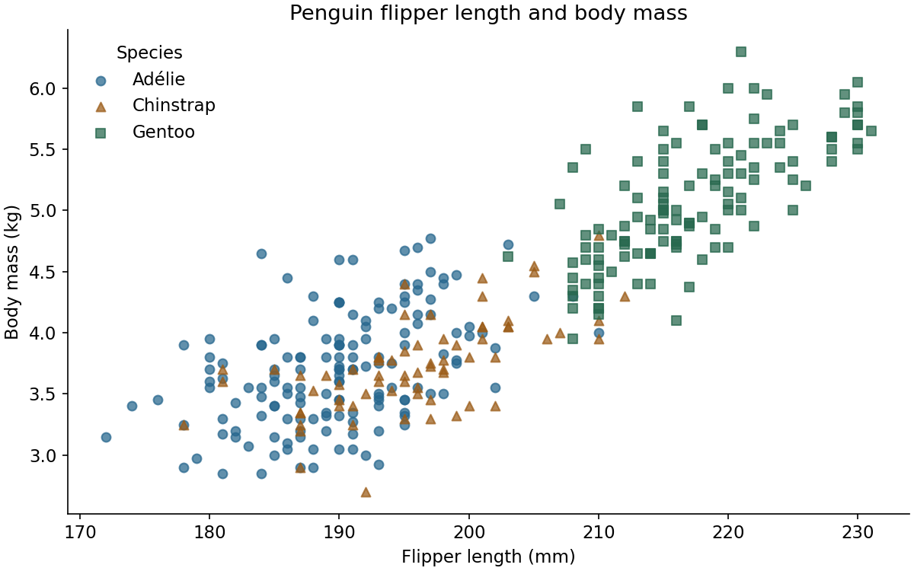

# Palmer Penguins | Flipper Length and Body Mass

This CIS215 capstone uses penguin measurements from the Palmer Archipelago to see how body mass varies with flipper length. It starts with a data quality check, compares the pooled and species-level relationships, and looks at how island coverage and recorded sex affect interpretation.

## Analysis question

Among the penguins in this dataset, how closely does flipper length go with body mass, and how does that relationship change within each species?

## Data source

Kristen Gorman and the Palmer Station Long-Term Ecological Research program collected the measurements in 2007–2009. Allison Horst, Alison Hill, and Kristen Gorman released the simplified CC0 CSV through [palmerpenguins](https://allisonhorst.github.io/palmerpenguins/articles/intro.html). The exact CSV version, access date, and ethics notes are in [data/README.md](data/README.md).

## Run the analysis

1. Clone the repository or extract the ZIP. Open a terminal or Anaconda Prompt in the project root, where this README is located.
2. Use Python 3.12. To create a separate environment with Anaconda, run `conda create -n penguins-capstone python=3.12`, then `conda activate penguins-capstone`.
3. Install packages with `python -m pip install -r requirements.txt`.
4. Start JupyterLab with `python -m jupyterlab`. Open [notebooks/penguin_analysis.ipynb](notebooks/penguin_analysis.ipynb), select the Python kernel for that environment, and choose **Kernel → Restart Kernel and Run All Cells**.
5. The CSV is included. The notebook regenerates three PNGs in [output/figures](output/figures). To review the original project commits, run `git log --oneline --reverse` in the project root.

## Key findings

- Of 344 observations, 342 had both flipper length and body mass.
- The pooled Pearson correlation was 0.87. Within species it was 0.47 for Adélie, 0.64 for Chinstrap, and 0.70 for Gentoo.
- Gentoo averaged 217.2 mm in flipper length and 5.08 kg in body mass, the highest averages among the three sampled species.
- In the recorded-sex comparison for Chinstrap, the correlation was 0.24 among females and 0.66 among males, with 34 observations in each group.

## Limitations and future work

The study covered adult foragers near Palmer Station over three field seasons. Chinstrap and Gentoo each came from one island in this dataset. Group sizes varied and some sex values were missing. The analysis describes associations in the sample. With more data, I would compare the same species across more islands and years, then estimate uncertainty around each subgroup correlation.

Gerardo Oburu Ndong · November 23, 2026
